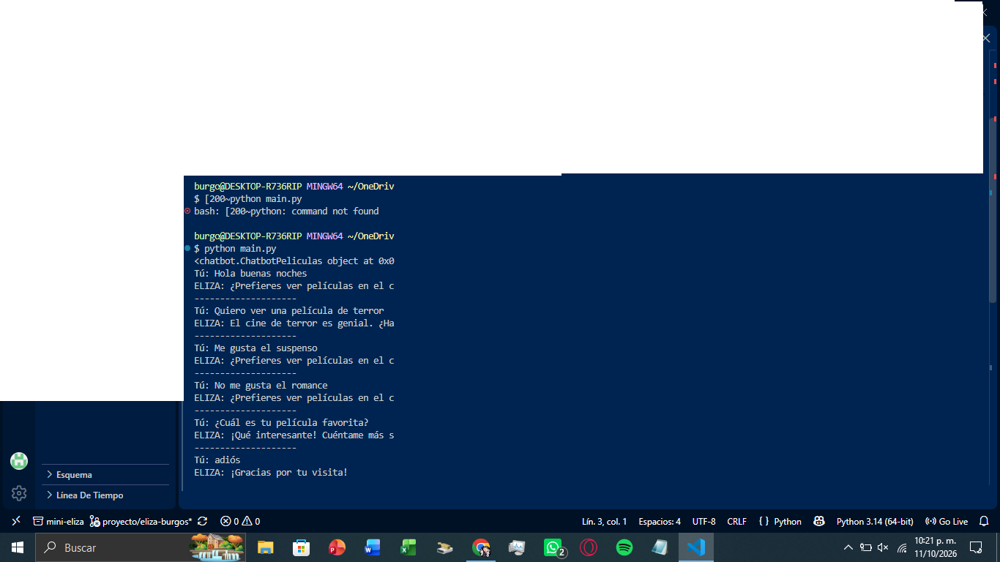

# Mini-ELIZA · CineBot

## Descripción del proyecto

Este proyecto consiste en crear un chatbot estilo ELIZA utilizando Python.

El tema que elegí para mi chatbot son las **películas**. El chatbot se llama **CineBot** y puede conversar con el usuario sobre películas favoritas, recomendaciones y géneros.

El programa no entiende realmente lo que escribe el usuario. Funciona mediante reglas y expresiones regulares que buscan palabras o frases específicas y después generan una respuesta.

## Tecnologías utilizadas

- Python
- Programación Orientada a Objetos (POO)
- Expresiones regulares (Regex)
- Visual Studio Code
- Git y GitHub

## Estructura del proyecto

```text
mini-eliza-peliculas/
│
├── chatbot.py
├── peliculas.py
├── main.py
└── README.md
```

### chatbot.py

Contiene la clase base `Chatbot`.

En esta clase se encuentran los reflejos de palabras, el método `reflejar()` y el método `responder()`.

### peliculas.py

Contiene la clase `ChatbotPeliculas`, que hereda de la clase `Chatbot`.

Aquí se encuentran las reglas relacionadas con el tema de películas.

### main.py

Contiene el programa principal y el ciclo de conversación utilizando `while True`.

El programa termina cuando el usuario escribe **"adiós"**.

## Cómo ejecutar el programa

Primero se debe abrir la carpeta del proyecto en Visual Studio Code.

Después se abre la terminal y se ejecuta:

```bash
python main.py
```

También se puede utilizar:

```bash
python3 main.py
```

Después de iniciar el programa, se pueden escribir diferentes frases para conversar con CineBot.

Para terminar la conversación se escribe:

```text
adiós
```

## Reglas del chatbot

CineBot cuenta con diferentes reglas para reconocer frases relacionadas con películas.

Algunas de ellas son:

- Saludar al usuario.
- Detectar si le gusta una película.
- Detectar si no le gusta una película.
- Preguntar por su película favorita.
- Recomendar películas.
- Reconocer géneros de películas.
- Hablar sobre la duración de las películas.
- Utilizar una regla comodín cuando no encuentra otra coincidencia.

La regla comodín `(.*)` se encuentra al final para que primero se revisen las demás reglas.

## Conversación de ejemplo

### Turno 1

**Tú:** Hola

**CineBot:** ¡Hola! Bienvenido al mundo del cine. ¿Qué película te gustaría comentar?

### Turno 2

**Tú:** Me gusta Toy Story

**CineBot:** ¡Qué bien! A mí también me interesa toy story. ¿Qué es lo que más te gusta de esa película?

### Turno 3

**Tú:** Mi película favorita es Spider-Man

**CineBot:** ¡spider-man suena interesante! ¿Qué es lo que más te gusta de ella?

### Turno 4

**Tú:** Recomiéndame una película

**CineBot:** Te recomiendo ver una película de aventura, comedia o ciencia ficción. ¿Qué género prefieres?

### Turno 5

**Tú:** Quiero ver Avatar

**CineBot:** ¡Buena elección! avatar podría ser una buena opción.

### Turno 6

**Tú:** Adiós

**CineBot:** ¡Gracias por hablar de películas!

## Captura de pantalla

Aquí se debe colocar una captura de pantalla de la ejecución del programa.

```text

```

La imagen debe guardarse dentro de la carpeta del proyecto con el nombre:

```text
captura.png
```

## Reflexión

Al realizar este proyecto aprendí que un chatbot puede responder a diferentes frases utilizando reglas y expresiones regulares. Aunque CineBot parece entender lo que escribo, en realidad solamente busca coincidencias en el texto y utiliza respuestas que ya fueron programadas. Esto se relaciona con el efecto ELIZA, porque sus respuestas pueden parecer inteligentes aunque el programa no comprenda realmente el significado de la conversación.

## Conclusión

Este proyecto me ayudó a practicar Python, especialmente la programación orientada a objetos, las expresiones regulares, las clases, la herencia y los métodos. También aprendí cómo organizar un proyecto en diferentes archivos y cómo probar un chatbot. 