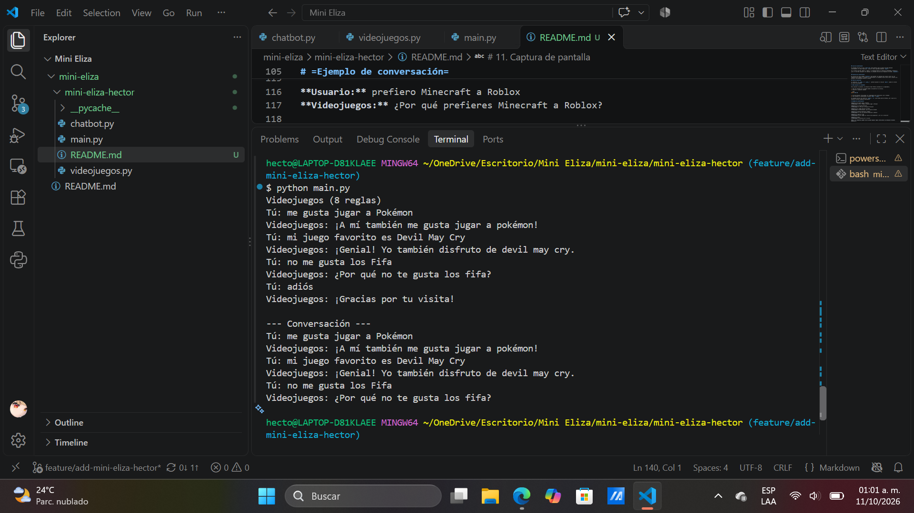

# =Mini-ELIZA Videojuegos=

# =Descripción del proyecto=

Mini-ELIZA Videojuegos es un chatbot desarrollado en Python que utiliza programación orientada a objetos (POO) para mantener conversaciones sencillas sobre videojuegos. El programa identifica patrones en los mensajes del usuario y genera respuestas a partir de reglas previamente definidas.

El objetivo del proyecto es aplicar conceptos de clases, herencia, métodos, diccionarios, listas y expresiones regulares para simular una conversación entre una persona y un chatbot.

# =Estructura del proyecto=

El proyecto está dividido en tres archivos principales:

- **`chatbot.py`:** contiene la clase base `Chatbot`, sus atributos y los métodos generales para procesar mensajes y generar respuestas.
- **`videojuegos.py`:** contiene la clase `ChatbotVideojuegos`, que hereda de la clase base y agrega reglas relacionadas con videojuegos.
- **`main.py`:** es el archivo principal que inicia el programa, recibe los mensajes del usuario y muestra el historial de la conversación.

# =Funcionamiento del archivo `chatbot.py`=

Este archivo contiene la clase base `Chatbot`, que establece la estructura general del programa y permite responder mensajes mediante patrones y plantillas.

## Librerías utilizadas

- **random:** permite seleccionar aleatoriamente una respuesta de las opciones disponibles.
- **re:** permite trabajar con expresiones regulares para buscar coincidencias en los mensajes del usuario.

## Atributos de la clase

- **`nombre`:** almacena el nombre del chatbot. Si no se proporciona uno, utiliza "Eliza".
- **`reflejos`:** es un diccionario que cambia algunas palabras para modificar la persona gramatical, como "yo" por "tú" y "me" por "te".
- **`reglas`:** es una lista que almacena los patrones y las posibles respuestas del chatbot.

## Métodos principales

- **`__init__()`:** inicializa el nombre, el diccionario de reflejos y la lista de reglas.
- **`__str__()`:** muestra el nombre del chatbot y la cantidad de reglas registradas.
- **`reflejar(fragmento)`:** convierte el texto a minúsculas, separa las palabras y sustituye aquellas que aparecen en el diccionario de reflejos.
- **`responder(texto)`:** limpia el mensaje del usuario, busca coincidencias con las reglas y selecciona una respuesta al azar. Si encuentra grupos de captura, refleja su contenido y lo utiliza para completar la respuesta. Si ninguna regla coincide, devuelve un mensaje predeterminado.

# =Funcionamiento del archivo `videojuegos.py`=

Este archivo contiene la clase `ChatbotVideojuegos`, que hereda de la clase `Chatbot`. Su función es adaptar el chatbot para conversar sobre gustos y preferencias relacionados con los videojuegos.

## Herencia e inicialización

La instrucción `class ChatbotVideojuegos(Chatbot)` permite reutilizar los atributos y métodos de la clase base.

En el método `__init__()` se utiliza `super().__init__(nombre)` para inicializar la clase padre y establecer el nombre del chatbot. Después, se define una lista de reglas específicas para el tema de videojuegos.

## Reglas de conversación

Las reglas utilizan expresiones regulares para reconocer diferentes frases que puede escribir el usuario. Cada regla contiene un patrón y una lista de posibles respuestas.

El chatbot puede responder a mensajes relacionados con:

- **Gustos personales:** reconoce frases como "me gusta jugar a Pokémon".
- **Preferencias negativas:** identifica expresiones como "no me gusta" y pregunta por el motivo.
- **Juego favorito:** permite hablar sobre el videojuego favorito del usuario.
- **Comparaciones:** reconoce frases como "prefiero un juego a otro" y pregunta por qué existe esa preferencia.
- **Juegos en línea:** responde a mensajes relacionados con los videojuegos que se juegan por internet.
- **Juegos de consola:** permite conversar sobre videojuegos y consolas.
- **Juegos de PC:** responde a comentarios sobre videojuegos para computadora.

## Selección de respuestas

Cuando el usuario escribe un mensaje, la clase base revisa los patrones definidos en esta subclase. Si encuentra una coincidencia válida, selecciona una respuesta aleatoria de las opciones disponibles y utiliza la información capturada para completar el mensaje.

# =Funcionamiento del archivo `main.py`=

El archivo `main.py` es el punto de entrada del programa. Se encarga de iniciar el chatbot, mantener la conversación y mostrar el historial de mensajes al finalizar.

## Inicio del programa

Se importa la clase `ChatbotVideojuegos` desde el archivo `videojuegos.py` y se crea una instancia del chatbot. Después, se muestra su información mediante `print(bot)`.

## Ciclo de conversación

El programa utiliza un ciclo `while True` para permitir que el usuario escriba mensajes continuamente. En cada repetición, recibe el texto ingresado mediante `input()`.

Si el usuario escribe "adiós" o "adios", el programa muestra un mensaje de despedida y termina el ciclo. Si escribe cualquier otro mensaje, el programa solicita una respuesta al método `responder()`.

## Historial de conversación

Se utiliza una lista llamada `historial` para guardar los mensajes del usuario junto con las respuestas del chatbot. Al terminar la conversación, el programa recorre esta lista y muestra los mensajes intercambiados durante la sesión.

## Punto de ejecución

La condición `if __name__ == "__main__":` permite ejecutar la función `main()` cuando el archivo se inicia directamente.

# =Cómo ejecutar el programa=

Para ejecutar el proyecto, es necesario tener Python instalado en la computadora.

1. Abre una terminal en la carpeta donde se encuentran los archivos.
2. Ejecuta el siguiente comando:

```bash
python main.py
```

3. Escribe mensajes relacionados con videojuegos para interactuar con el chatbot.
4. Para terminar la conversación, escribe `adiós` o `adios`.

El programa utiliza las librerías `random` y `re`, que forman parte de Python, por lo que no es necesario instalar paquetes adicionales.

# =Ejemplo de conversación=

**Usuario:** me gusta jugar a Pokémon  
**Videojuegos:** ¡A mí también me gusta jugar a Pokémon!

**Usuario:** no me gusta Fortnite  
**Videojuegos:** ¿Por qué no te gusta Fortnite?

**Usuario:** mi juego favorito es Zelda  
**Videojuegos:** ¡Interesante! ¿Qué te gusta de Zelda?

**Usuario:** prefiero Minecraft a Roblox  
**Videojuegos:** ¿Por qué prefieres Minecraft a Roblox?

**Usuario:** juego en línea  
**Videojuegos:** ¡Los juegos en línea son muy populares! ¿Cuál es tu favorito?

**Usuario:** adiós  
**Videojuegos:** ¡Gracias por tu visita!

*Nota: las respuestas pueden variar porque algunas reglas seleccionan sus mensajes de manera aleatoria.*

# =Reflexión: ¿el chatbot comprende lo que le escriben?=

El chatbot no comprende realmente los mensajes como lo haría una persona. Su funcionamiento consiste en identificar patrones de texto y seleccionar respuestas que fueron programadas previamente. Esto se relaciona con el efecto ELIZA, porque puede dar la impresión de que entiende al usuario, aunque en realidad sigue reglas definidas.

# =Conclusión=

El desarrollo de Mini-ELIZA Videojuegos permite comprender cómo se pueden utilizar las clases, la herencia y las expresiones regulares para construir un chatbot sencillo. También demuestra que es posible simular una conversación mediante patrones y respuestas predefinidas, aunque esto no significa que el programa tenga una comprensión real del lenguaje humano.

# 10. Repositorio de GitHub

https://github.com/A-mont/mini-eliza.git

# 11. Captura de pantalla

